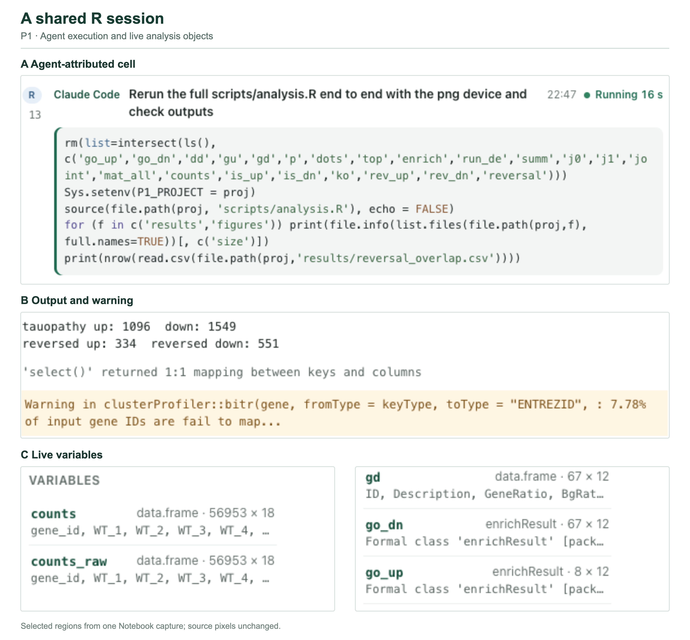
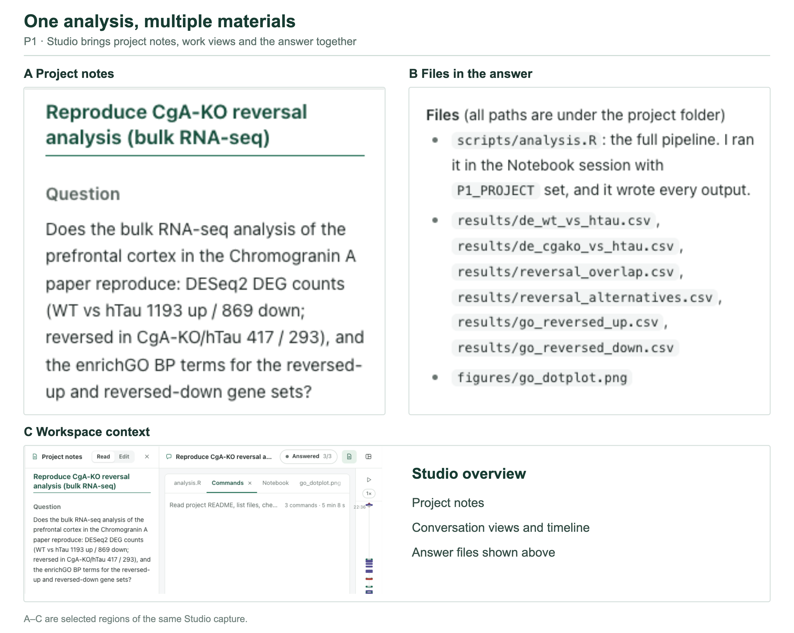
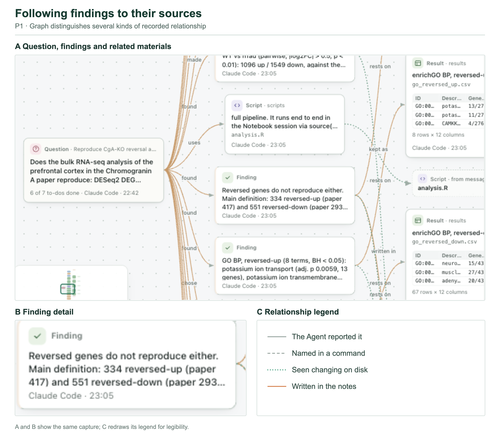
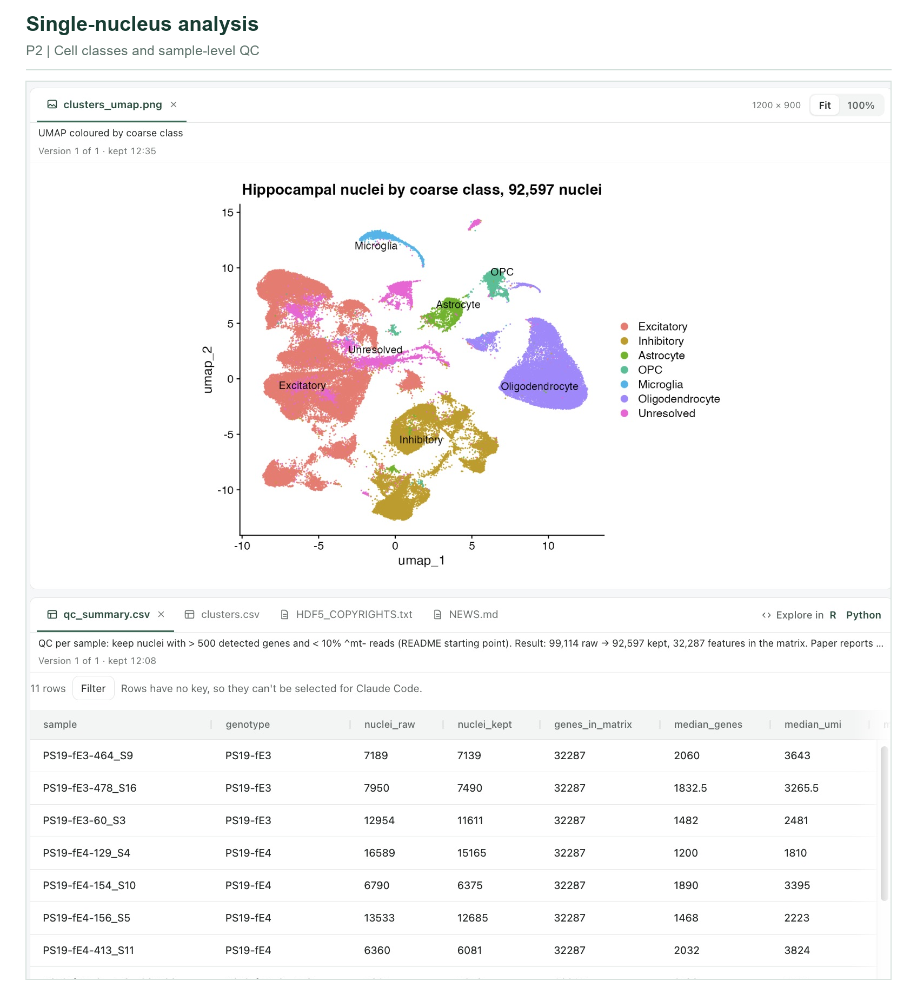
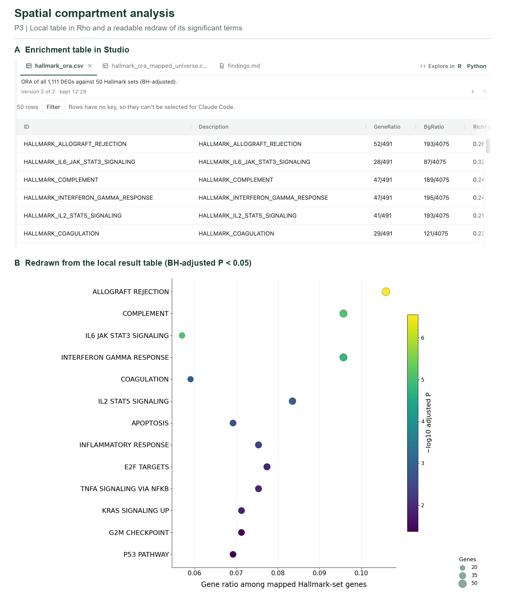
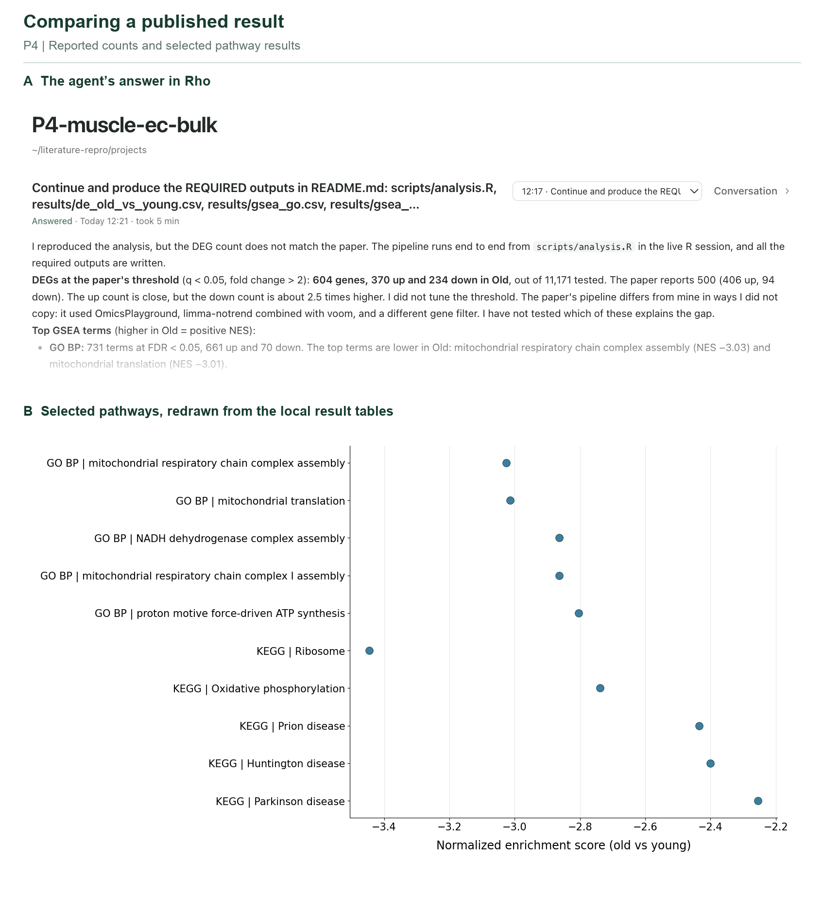
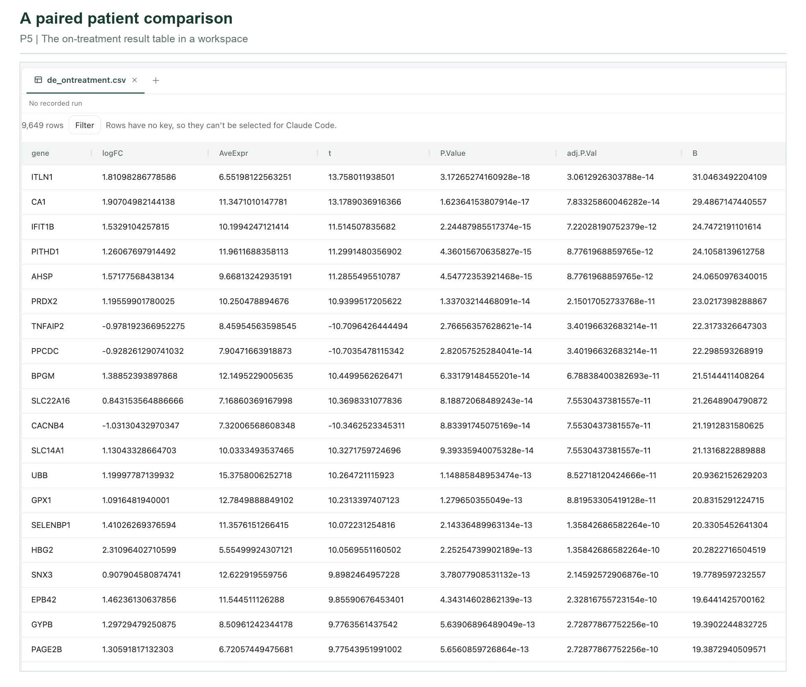
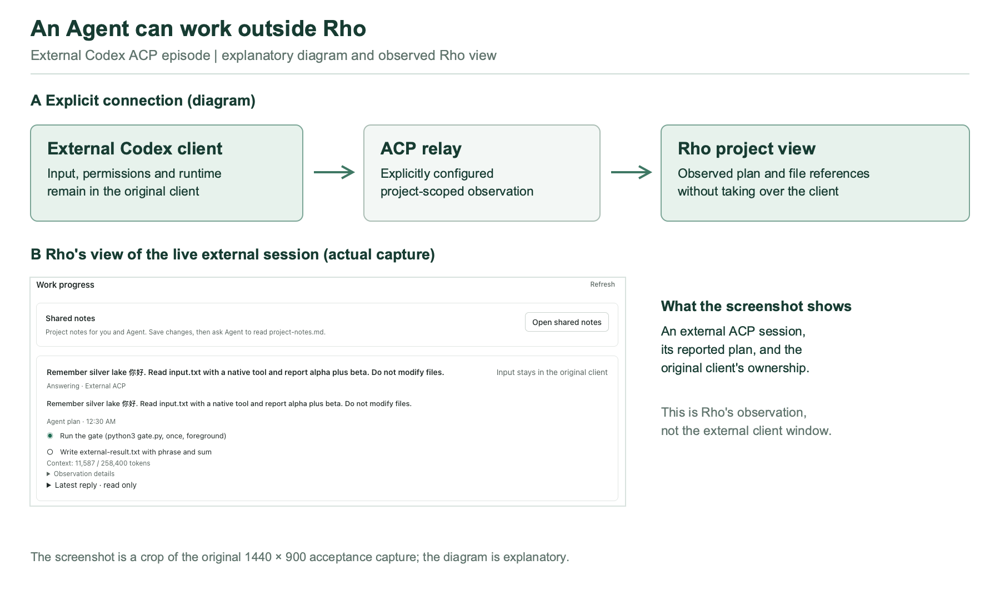

# Rho: A Human–AI Collaborative Interface for Discovering Questions and Testing Explanations

**Yonghe Xia**¹ ([xiayonghe@westlake.edu.cn](mailto:xiayonghe@westlake.edu.cn)) and **Guangchuang Yu**²,* ([gcyu1@smu.edu.cn](mailto:gcyu1@smu.edu.cn))

¹ School of Medicine, Westlake University, Hangzhou, China 
² Department of Bioinformatics, School of Basic Medical Sciences, Southern Medical University, Guangzhou, China 
\* Corresponding author

> Working draft, 2 November 2026. The application-test episode and its underlying session exports have not yet been published by the Rho repository. The case descriptions below are provisional until that record has a durable public reference. Figures include original 1440 × 900 captures and native-pixel crops of reopened projects captured at 3840 × 1972; they show particular states, not a user study. Check readability again against the eventual journal layout.

## Abstract

Data analysis rarely ends with the first figure or a single answer. A result can raise a new question, disagree with a published analysis, or expose a choice that must be revisited before an explanation is credible. When an AI agent performs the computation, the researcher must also be able to inspect what ran, which objects and outputs are available, and how a reported finding relates to them. We present Rho, a human–AI collaborative interface that brings an agent, a shared computational session, project materials, and views of an analysis process into the same workspace. Rho is designed to support a cycle in which people and agents formulate questions, produce and inspect results, and revise or continue an analysis. We illustrate the interface using five locally run analyses based on public datasets from published studies. These examples cover selected expression-analysis tasks, not complete reproductions of the studies. In one bulk RNA-seq case, the recovered differential-expression counts differed from the published counts; Rho displayed the analysis, outputs, notes, and reported choices for inspection. A single-nucleus case brings sample-level replication and cell annotations into view as questions for further analysis. The observations demonstrate concrete interface behaviour under one configuration, while leaving usability, comparative benefit, and the scientific validity of individual analyses to further evaluation.

## 1. Introduction

An analysis becomes interesting when its first result is not the end of the question. A contrast may produce a pattern that invites a mechanistic explanation; a reanalysis may yield counts that differ from a published figure; a comparison may prompt closer examination of the samples and cell types involved. In each case, the next step depends on more than the latest answer. Researchers need to see the comparison, the data and code that produced it, the relevant results, and the choices that make an interpretation plausible or questionable.

AI agents can write code and run analyses, but their outputs do not remove this need. An agent's answer may summarize a result without exposing the observation unit, a changed input, or the analysis choices behind it. A conversation transcript can preserve the sequence of messages while leaving the researcher to reconstruct how a claim, file, calculation, and decision relate. Conversely, an analysis interface may make a figure visible without making the agent's computational state or subsequent context accessible.

Rho approaches this problem as a shared working environment. An agent can execute R code in a Notebook session that the person can also inspect and use. Project notes, files, variables, outputs, and views of the process provide entry points into the work. Studio brings materials from a conversation together for review; Graph presents relationships recorded or observed from different sources. These representations support inspection, but a displayed relationship is not itself proof that a scientific claim is correct or that an agent has incorporated every change.

We use *discovering questions* broadly: a question may be supplied by the researcher, emerge from a discrepancy, or follow from an incomplete result. *Testing explanations* means making an explanation answerable to particular results and analysis choices; it does not mean that the interface can validate a biological mechanism by itself. Our aim is to make the movement between question, computation, result, and interpretation a visible part of collaborative analysis.

This paper makes three contributions. First, it describes Rho as an interface that connects agent work with a shared analysis session and inspectable project materials. Second, it develops concrete cases in which a published-result discrepancy, a single-nucleus comparison, and alternative analytical choices give the researcher different reasons to inspect or continue the work. Third, it illustrates the interface with five selected analyses using public data from published studies. These observations are not evidence of improved understanding, a comparison against other systems, or a user study.

## 2. An analysis in Rho: a discrepancy becomes a question

### 2.1 The task

The first project started from a published bulk RNA-seq study of chromogranin A and tauopathy and its GEO data ([Jati et al., PMID 40393970](https://pubmed.ncbi.nlm.nih.gov/40393970/)). The requested task was narrower than reproducing the paper: recompute specified differential-expression and reversal counts, perform GO biological-process enrichment, and record outputs and choices. The public data had been downloaded before the run. A local project README stated the comparisons and expected files; the 17 samples comprised five wild-type, six hTau and six CgA-KO/hTau samples. The agent executed R code in Rho's shared Notebook session, using two pairwise DESeq2 contrasts with nominal P < 0.01 and |log2 fold change| > 0.5.

The first result was a discrepancy, not a confirmation. The local run reported 1,096 up- and 1,549 down-regulated genes for the first contrast, versus 1,193 and 869 reported in the task's comparison with the paper. The reversal counts were 334 and 551, versus 417 and 293. The recorded analysis retained alternative reversal definitions in a separate table. These counts describe one run and one comparison; they do not establish why the published numbers differed, nor do they establish which definition is scientifically correct.

The discrepancy changes what the researcher needs to inspect. Rather than asking only whether the run produced a figure, the researcher can ask which samples and contrast were used, how reversal was defined, which choices affected the counts, and whether those choices match the published analysis. Rho's role in this case is to keep the computation and its materials available for that investigation.

### 2.2 Inspecting the computation

**Figure 1. Shared computation in the P1 Notebook.** Enlarged regions of a single capture show (A) an R cell attributed to Claude Code, with its stated purpose and elapsed time; (B) reported counts and a gene-mapping warning; and (C) two parts of the live Variables pane, including `enrichResult` objects. The capture records a state during the local application test of Rho 0.5.2. Regions have been rearranged for legibility; screenshot content is unchanged.

The Notebook made it possible to inspect an agent-attributed cell alongside its output and live variables. The same session contained data frames, plotting objects, and enrichment results. This is an observed property of the run: it does not mean that every analysis choice was correct, and it does not by itself show that the person understood or endorsed an output.

### 2.3 Bringing the analysis back together

**Figure 2. P1 in Studio.** Enlarged regions show (A) the question in project notes and (B) the files listed in the agent's answer. (C) A region of the same capture shows the conversation's work views and timeline. The regions have been rearranged for legibility; their presence does not establish that each component was read by the agent.

Studio places the written question next to the materials produced during the work. The local notes identify the data and method, list files, and preserve the unresolved difference in counts. This layout makes it possible to move from a conclusion to a relevant script, output, or recorded choice without treating a generated summary as the only source of truth. It is one concrete arrangement observed in this project; the test did not establish that Rho automatically selects an optimal arrangement for every research question.

**Figure 3. P1 in Graph.** (A) A region of the graph relates the question, findings, script and result files. (B) An enlarged detail repeats one finding from A. (C) The relationship legend is redrawn from the same capture for legibility. Edges make recorded associations navigable; they do not certify the validity of a scientific explanation.

Graph provides another route through the same project. In the recorded state, it showed four findings and five choices from the notes, alongside files and runs. The provenance legend matters: an agent's report that a result exists, a filename mentioned in a command, an observed disk change, and a statement in notes are different kinds of evidence. Keeping them distinct helps the reader identify what still requires checking. It does not convert the graph into a validated model of the scientific reasoning.

## 3. Four further analyses: different questions, different evidence

### 3.1 Single-nucleus data: what is the biological replicate?

The second project used hippocampal single-nucleus data from a study of neuronal APOE4 removal ([Koutsodendris et al., PMID 37118426](https://pubmed.ncbi.nlm.nih.gov/37118426/); GEO GSE221215). The local task began with 11 samples and retained 92,597 nuclei after quality control. The agent's analysis clustered the nuclei and assigned coarse cell classes; 8,364 nuclei remained unresolved. These labels are working annotations, not independently validated cell identities.

**Figure 4. Single-nucleus classes and sample-level quality control.** A crop of the reopened P2 Studio displays the saved UMAP and per-sample QC table. The source capture was 3840 × 1972 pixels; the figure preserves the pixels in the selected region. The classes are preliminary, and the R session was no longer live when this view was captured.

The visual grouping opens a more specific question: do the apparent differences reflect the biological samples, or merely the number of nuclei contributed by each one? The local excitatory-neuron comparison contained 20,832 PS19-fE4 and 8,533 PS19-fE3 nuclei from four and three mice, respectively. Its cell-level Wilcoxon test did not model dependence among nuclei from the same mouse. A large number of nuclei therefore does not provide the same replication as a large number of mice. The per-sample QC table and the UMAP serve different purposes: one exposes sample contributions, while the other shows how the assigned classes occupy the embedding. Neither establishes that the differential-expression list is reliable.

This local comparison also asks a different question from the original study's central neuronal APOE4-deletion intervention. The gene list was not compared with the paper's list. A defensible continuation would validate the class labels, align the intended contrast with the study, and repeat the comparison with an appropriate sample-aware model. Rho makes the materials for that decision accessible; it does not supply the biological judgement.

### 3.2 Spatial profiling: which compartment supports an explanation?

The third project used the GeoMx digital spatial profiling dataset GSE232853 from a diffuse large B-cell lymphoma study ([PMID 38459052](https://pubmed.ncbi.nlm.nih.gov/38459052/)). The local matrix contained 16,560 genes and 578 areas of illumination, including CD68- and CD20-selected segments. The task compared those two compartments, first checking marker expression and then fitting a limma model with `duplicateCorrelation` for paired segments. The project also retained paired-only and unpaired alternatives, making the choice of comparison inspectable.

**Figure 5. From a compartment comparison to its pathway table.** (A) A native-pixel crop of the reopened P3 Studio shows the saved Hallmark table; the original display capture was 3840 × 1972 pixels. (B) A separately redrawn plot uses the same local table and displays the 13 terms with Benjamini–Hochberg-adjusted P < 0.05. Point position is the recorded gene ratio, size is the number of genes, and colour encodes adjusted P. The redraw is not a screenshot or a new enrichment analysis.

At adjusted P < 0.05 and |log2 fold change| > 0.58, the main analysis reported 1,111 differentially expressed genes, of which 833 were higher in CD68 and 278 higher in CD20. An over-representation analysis of the combined list identified 13 significant Hallmark sets, including complement and interferon-gamma response. Because the analysis pooled both directions, an enriched term does not say which compartment drives it. The relevant next question is therefore directional: does the same pathway appear when genes higher in each compartment are analysed separately? The recorded panel background matters as well; these results describe enrichment within the measured gene panel, not an unrestricted genome-wide universe.

The local matrix did not include the spatial-region labels required for the original study's region-level comparison, and the original Hallmark results were not available for a direct comparison. The case illustrates how a graph, table, analysis design and retained alternatives can inform the next question, not a replication of the full spatial study.

### 3.3 Ageing endothelium: why do reported counts differ?

The fourth project examined the transcriptomic arm of an ageing study that also included metabolomics ([PMID 39868046](https://pubmed.ncbi.nlm.nih.gov/39868046/); GSE270697). The local analysis used three old and four young mouse skeletal-muscle endothelial samples. After transcript-to-gene mapping and filtering, it fitted a limma–voom comparison. At BH-adjusted P < 0.05 and |log2 fold change| > 1, it reported 604 genes: 370 higher and 234 lower in old samples. The project records the paper's corresponding total as 500, comprising 406 higher and 94 lower. These figures make the discrepancy visible without explaining it.

**Figure 6. A discrepancy and selected pathways in P4.** (A) A native-pixel crop of the reopened project shows the agent's reported counts; the original display capture was 3840 × 1972 pixels. (B) A separate redraw shows the five terms with the lowest adjusted P from each local GO BP and KEGG table. The redraw is not a screenshot or a new analysis. The answer is the agent's interpretation, not independent validation of its explanation.

The saved choices identify several questions that a reviewer can pursue. The local analysis used an Ensembl 102 transcript map and a particular expression filter, whereas the paper used a different analysis pipeline. Alternative annotation and filtering were recorded, but their reported sensitivity totals use adjusted P alone, so they cannot be directly compared with the 604-gene count that also applies a fold-change threshold. One transcript absent from the candidate annotations accounted for approximately 34% of counts in each sample; its effect on normalization was not measured. These observations identify potential sources of difference, not a tested cause.

The pathway view offers a second example of why the underlying table matters. In the local ranked analysis, KEGG oxidative phosphorylation had a negative normalized enrichment score (−2.74) for old versus young. The original project plot contains only the ten most significant terms per source; the redraw in Figure 6 shows five per source. All terms in these selections are lower in old samples, which should not be read as the direction of every significant pathway. The metabolomics arm was not analysed in this project.

### 3.4 Patient transcriptomes: separating a paired comparison from response prediction

The fifth project used the blood-expression component of a multi-omics mesothelioma study ([PMID 39731918](https://pubmed.ncbi.nlm.nih.gov/39731918/); GSE252990). Its local matrix contained measurements from 40 patients at three time points. At baseline, 23 were recorded as responders and 17 as non-responders, whereas the study's phase II cohort was reported as 31 and 23. These are different scopes: the available matrix does not represent the entire 54-person cohort.

**Figure 7. A saved patient-level comparison in a Rho workspace.** The table shows the local on-treatment versus baseline results, reopened after the run. The source capture was 3840 × 1972 pixels and the selected region retains its original pixels. The view presents a saved table; the historical notebook and project records are needed to inspect its analysis context.

For the on-treatment question, the analysis paired baseline and C3D1 samples from the same 40 patients using a patient-plus-time design. The available expression matrix contained continuous, apparently normalized values, so the main local analysis applied log2(x + 1) and limma `lmFit`/`eBayes`; it reported 2,596 genes at BH-adjusted P < 0.05. An alternative that applied voom directly to the supplied values reported 4,532. This contrast between outputs exposes sensitivity to input handling; it is not evidence that treating normalized values as counts is appropriate, or that either count is a verified biological finding.

The pairing addresses within-patient change and asks a different question from baseline prediction of response. It also does not, by itself, distinguish treatment effects from other changes over time. The useful continuation is to establish the matrix's processing history, check the model and sample metadata, and compare the appropriate contrast with the original study. The local project did not analyse the study's single-cell component.

The five analyses used one agent, one model and one local machine; the public data were downloaded before the runs. They illustrate selected tasks and interface states, not complete reproductions, a benchmark, or a user study. Their underlying implementation record is not yet publicly available.

## 4. Collaboration beyond the Rho window

An agent need not originate in Rho for a researcher to bring its work into the project. In an [installed external ACP episode](https://github.com/YuLab-SMU/Rho/blob/main/docs/ACP-MULTI-AGENT-EPISODE.md), an existing Codex session used an explicitly configured relay. The original client retained its input, permission choices and runtime, while Rho displayed the external session's reported plan and references to project files. The observed plan describes the agent's activity; a file reference or current file hash does not alone establish authorship or scientific correctness. This is a specific relay-based connection, not passive attachment to an arbitrary running client.

**Figure 8. An external agent and Rho.** (A) An explanatory diagram of the explicit ACP connection. (B) An actual Rho-side capture during the separate installed external Codex episode, showing a live reported plan; the original capture was 1440 × 900 pixels. It does not show the external client window. This episode used a different package composition from the five 0.5.2 analysis projects.

A separate [base-R collaboration episode](https://github.com/YuLab-SMU/Rho/blob/main/docs/BASE-R-EPISODE.md) demonstrates the scientific handoff itself. An automated operator selected May in an `airquality` table and asked an external Claude Code agent why there were 24 observations and to exclude only missing ozone values. The agent received the selected row and version through a project-scoped MCP handoff, changed the script and linked the recalculated outputs. May changed from 24 observations with mean ozone 24.125 to 26 with mean 23.615; an independent base-R expression checked the five monthly aggregates. The original and new tables remained separately available for comparison. This is a controlled demonstration with an automated operator, not evidence of human usability or a validation of the missing-data assumption.

Rho's bundled [PA14 quorum-sensing project](https://github.com/YuLab-SMU/Rho/blob/64d73550f4bb1786e6cec42071fbe8a67a8ba230/example/pa14-qs/README.md) provides another starting point. It brings together swarming measurements, co-culture ratios, RNA-seq counts and annotations to ask what the las and rhl systems contribute to collective behaviour. It is an illustrative project, not a sixth independent analysis in the five-project episode.

## 5. Discussion and next evidence

Rho's central design question is how a person and an agent can return to an analysis as a connected body of work: a question, its materials, computational activity, results, and decisions. The cases make this question concrete, but they do not establish that the interface improves discovery or explanation testing. Prior work on insight management, process inspection, intent-driven interfaces, shared scientific context and editable memory must be compared at the level of reported mechanisms; none of those capabilities should be presented as uniquely new to Rho without that comparison.

The next evidence should include a publicly reachable versioned record of these runs, checks of the scientific analyses by domain experts, and observations of researchers using the interface for their own questions. A comparative study would be needed to test whether Rho changes users' ability to identify a discrepancy, locate its basis, or decide what to do next.
